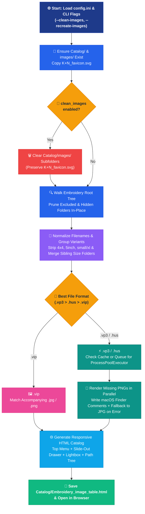

<p align="center">
  
</p>

# 🧵 Embroidery Stitch File Catalog `v1.0.0`

A fast, offline Python application that recursively scans your Husqvarna embroidery library (`.vp3`, `.hus`, and `.vip`), intelligently collapses duplicate hoop sizes into a single card, renders cached PNG thumbnails across all CPU cores, and generates a sleek, searchable HTML catalog grouped by category folder.

---

## 🖼️ Web Viewer Preview

<p align="center">
  
</p>

---

## ✨ Enhancements & Features

| Feature | What It Does |
| :--- | :--- |
| 🧵 **Multi-Format Support (`.vp3`, `.hus`, `.vip`)** | Renders `.vp3` and `.hus` natively via `pyembroidery` (with automatic `.jpg`/`.png` fallback if a file cannot be decoded) and pairs `.vip` designs directly with their accompanying folder image. |
| 📐 **Smart Size-Aware Deduplication** | Strips hoop dimensions (`4x4`, `5X7`, `6x10`, `birthdayballoons4x4`, `130x180mm`), single-dimension sizes (`5inch`–`8inch`, `15cm`, `130mm`), and size labels (`small`, `med`, `large`, `xl`) to merge variants into **one card** while keeping numbered designs (like `04 block` vs. `05 block`) separate. |
| 📁 **Cross-Subfolder Merging** | Automatically collapses size or format variants even when organized into sibling subfolders (such as `5inch/`, `6inch/`, `4x4/`, or `VP3/`), picking the highest-priority format (`.vp3` → `.hus` → `.vip`) and largest size as the preview thumbnail. |
| ⚡ **Multi-Core Rendering & Caching** | Uses `ProcessPoolExecutor` to render missing PNGs across all CPU cores, skips already-cached thumbnails, prevents filename collisions across subfolders, and prunes excluded directories in place during `os.walk`. |
| 🔍 **In-Page Lightbox Pop-Up** | Clicking any thumbnail opens a full-size modal preview with **Prev / Next** navigation (plus `←` / `→` arrow keys and `Esc` to close), format/size badges, a directory tree, and a one-click **Copy Path** button. Clicking the design title never triggers a file download. |
| 🌳 **Visual Directory Tree (`📂 Path`)** | Clicking **Path** on any card expands an indented folder tree from your root embroidery directory down to the exact subfolder and lists every stitch file in that design group (highlighting the primary thumbnail file) with a **Copy Folder Path** button. |
| 🧭 **Dual Navigation (Top Menu + Slide-Out Drawer)** | Keeps the full category jump grid at the top of the page **and** adds a pinned **☰ Folders** button in the sticky search bar that slides out a filterable side navigation drawer from anywhere on the page. |
| 🔎 **Instant Multi-Word Card Search** | Debounced, card-level search filters individual designs by name, folder, format, or hoop size, updates per-category counts live, hides empty sections, and uses `loading="lazy"` so catalogs with thousands of designs open smoothly. |
| 🧹 **Rebuild & Clean Options** | Includes `recreate_images` / `--recreate-images` to force re-rendering and `clean_images` / `--clean-images` to wipe old cached folders in `Catalog/images/` (while preserving `K+N_favicon.svg`). |
| 🏷️ **macOS Finder Comments** | Automatically writes the relative stitch file path into each rendered PNG's Spotlight/Finder comment via `osxmetadata` when running on macOS. |

---

## 🗺️ Application Flowchart



---

## 📂 Expected Directory Structure

Top-level folders inside `root_embroidery_directory` automatically become categories in both the top menu and the slide-out **☰ Folders** drawer:

```text
Embroidery Thumbnails/
├── _My Designs/
├── 4th of July/
│   ├── 3StarsApplique+-+EB/
│   │   ├── 3 Stars Applique 4x4.vp3
│   │   ├── 3 Stars Applique 5x5.vp3
│   │   ├── 3 Stars Applique 5x7.vp3
│   │   └── 3 Stars Applique 6x10.vp3
├── Baby/
│   └── DBJJ Sleepytime Critters/
│       ├── DBJJ Sleepytime Critters Applique2 04 block 5inch.vp3
│       ├── DBJJ Sleepytime Critters Applique2 04 block 6inch.vp3
│       └── DBJJ Sleepytime Critters Applique2 04 block 8inch.vp3
├── Birthdays/
└── Catalog/                              # Auto-created output folder
    ├── Embroidery_image_table.html       # Generated interactive viewer
    └── images/
        ├── K+N_favicon.svg               # Preserved during --clean-images
        ├── 4th of July/
        └── Baby/
```

---

## ⚙️ Configuration (`config.ini`)

Copy `config.sample.ini` to `config.ini` in the project folder and customize your paths and preferences (`config.ini` is git-ignored so your personal paths stay private):

```bash
cp config.sample.ini config.ini
```

```ini
[General]
root_embroidery_directory = ~/Documents/Embroidery Thumbnails
embroidery_start_directory = ~/Documents/Embroidery Thumbnails
excluded_folders = Alphabets & Monograms, Catalog, Images, Colorcharts
table_cols = 6
max_files = 100000
log_level = info
recreate_images = false
clean_images = false
```

| Setting | Default | Description |
| :--- | :--- | :--- |
| `root_embroidery_directory` | — | Root embroidery library folder (also where `Catalog/` is created). |
| `embroidery_start_directory` | — | Starting folder to scan (can be the root or a specific category subfolder). |
| `excluded_folders` | `Alphabets & Monograms, Catalog, Images, Colorcharts` | Comma-separated folder names/keywords skipped during scanning (case-insensitive). |
| `table_cols` | `6` | Maximum number of card columns in the responsive grid on wide screens. |
| `max_files` | `100000` | Maximum number of deduplicated unique designs to include. |
| `log_level` | `info` | Console verbosity: `debug`, `info`, `warning`, `error`, or `critical`. |
| `recreate_images` | `false` | Set `true` to re-render PNGs for all scanned designs even if cached. |
| `clean_images` | `false` | Set `true` to delete all folders/files in `Catalog/images/` (except `K+N_favicon.svg`) before rendering. |

---

## 🚀 Installation & Usage

### 1. Install Dependencies
```bash
pip install -r requirements.txt
```

### 2. Run the Catalog Generator
```bash
# Standard run (uses cached PNGs, renders only new designs)
python3 Embroidery_Stitch_File_Catalog.py

# Force re-rendering all scanned thumbnails
python3 Embroidery_Stitch_File_Catalog.py --recreate-images

# Wipe all cached image folders (keeping K+N_favicon.svg) and rebuild cleanly
python3 Embroidery_Stitch_File_Catalog.py --clean-images
```

---

## 💻 Operating Environment
- Built for **Python 3.10+** (tested on macOS with Python 3.14 and `pyembroidery 1.5.1`).
- `osxmetadata` is optional and automatically skipped on non-macOS systems.
